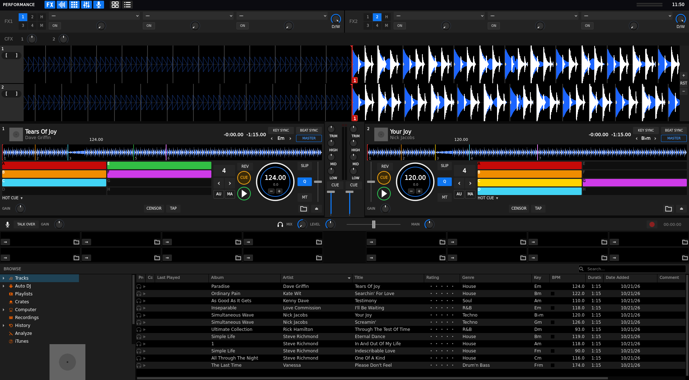

# Rekordmixxx

A Mixxx skin that borrows the look of rekordbox 7's Performance mode. Dark panels, stacked waveforms, blue-line faders, a ringed jog with the BPM in the middle. I wanted the layout I'm used to, running on Mixxx and doing real Mixxx things.

It needs Mixxx 2.4 or newer. I built and tested it on 2.5.6.

## Install

[**Download the latest release**](../../releases/latest), unzip it, and drop the `Rekordmixxx` folder into your Mixxx skins folder:

| OS | Skins folder |
|---|---|
| Linux | `~/.mixxx/skins/` |
| Linux (Flatpak) | `~/.var/app/org.mixxx.Mixxx/.mixxx/skins/` |
| macOS | `~/Library/Containers/org.mixxx.mixxx/Data/Library/Application Support/Mixxx/skins/` |
| Windows | `%LOCALAPPDATA%\Mixxx\skins\` |

Restart Mixxx, then pick **Rekordmixxx** under Preferences > Interface. There are two colour schemes, Dark (blue) and Amber.

One tip: set Preferences > Waveforms to **Filtered** or **RGB**. The skin colours them like rekordbox's 3-band waveform (blue lows, orange mids, white highs).

## What you get

- A global bar with panel toggles, a clock and master meters
- Stacked waveforms with deck tabs, loop in/out and a zoom strip
- Two player panels (four if you switch on 4-deck mode) with KEY SYNC, BEAT SYNC and MASTER, pads, CUE and PLAY rings, SLIP, Q and MT
- Pads that switch between Hot Cue, Beat Loop, Beat Jump and Loop Roll (click the mode name; right-click goes back)
- A centre mixer, effect units with a colour-FX row, mic and headphone controls, 16 samplers and a themed library

The FX panel is hidden at first. Turn it on with the FX button in the top bar.

## What's different from the real thing

- Hotcue pads fill completely with the cue colour, and there are no cue times. Mixxx doesn't allow anything fancier.
- There's no GROOVE CIRCUIT, MIX POINT LINK, STEMS or lighting panel, since Mixxx has nothing to hook them to.
- I added a thin tempo fader beside each jog. Rekordbox doesn't have one, but I missed it.

## Heads up

I tested it in a real Mixxx under a virtual display, so the OpenGL waveforms, the spinning jog marker and live level meters haven't been seen on a real GPU yet. If something looks off, please open an issue.

## License

CC BY-SA 4.0. Rekordbox is a trademark of AlphaTheta Corporation. This project is independent and not affiliated with them, and all artwork here is original.
